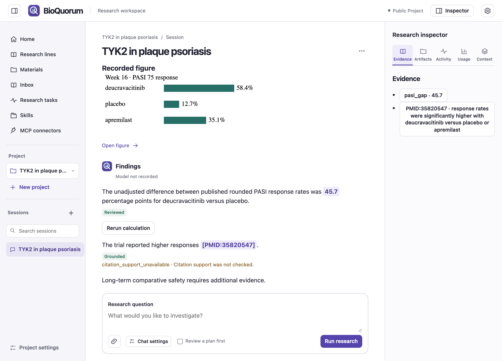

# BioQuorum

> 我并没有实质参与过抗体药物的研发。那我想试一下，只通过这套Harness加最好的模型，可不可以得到一个候选抗体序列,并把一个抗体序列推到PCC阶段
>
> I haven’t been substantively involved in antibody drug development. I want to see whether I can use this harness and the best models available to generate a candidate antibody sequence and advance it to preclinical candidate (PCC) nomination.

**BioQuorum is an open, model-neutral workbench for biomedical research. Ask a question, inspect the source passage or calculation behind a claim, and export the record so another researcher can check your work.**

**v1.0 release candidate (`1.0.0rc1`) is ready for a research trial from the source checkout.** Explore four offline projects covering a TYK2 trial, donor-paired gene expression, a metformin evidence review and a sample-label correction. [Offline projects](docs/demo-v1.0.md) · [Handbook](docs/index.md) · [Release and acceptance status](docs/release/v1.0-acceptance.md)

[](docs/media/tyk2-workbench.mp4)

## Quick start

With Python 3.12+ and [uv](https://docs.astral.sh/uv/), launch the bundled offline example from a source checkout.

```bash
git clone https://github.com/the8thday/bioquorum
cd bioquorum
uv sync --locked
uv run bioquorum
```

Open the metformin example, submit its plan and approve the run. Click a number to see its recorded output or a citation to read the highlighted passage. Open **Audit log** to inspect the session's tools, permissions and isolation settings. The example uses recorded model replies and a simulated kernel, so it runs without an API key. [Workbench walkthrough](docs/demo-v0.3.md)

To try the TYK2 project, extract `examples/v1/projects/target.zip` into a new directory and run `uv run bq workbench -C <directory>`. Open the reported response-rate difference to see its source data and calculation. [Recorded walkthrough and other projects](docs/demo-v1.0.md)

### Use your own project

From the checkout, initialize a separate project directory. This example is for public data.

```bash
uv run bq project init -C ~/bq-demo --classification public
```

Configure the worker, reviewer and any MCP servers in `~/bq-demo/bioquorum.toml`. For a hosted model, set the API key in the terminal that starts the workbench. For a local model, use the Ollama configuration in the deployment guide. [Provider and MCP configuration example](docs/demo-v0.1.md) · [Local model configuration](docs/demo-v0.6.md)

```bash
uv run bq models -C ~/bq-demo
uv run bq workbench -C ~/bq-demo
```

## What you can do

| Research task | What the workbench records |
|---|---|
| Check a target assessment | Follow a quote to its retrieved source and inspect the review of the claim it supports. The IL23R/IBD example produces an evidence bundle. In four additional target questions, the local model missed key sources during autonomous retrieval. [Scenario results](docs/research/v05-scenarios.md) · [Coverage evaluation](docs/research/v05-target-expansion.md) |
| Revisit an analysis | Inspect named values, code and input hashes. The GSE96583 example reran single-cell QC with alternative thresholds and compared donor-paired results. Its bundle includes an editable Methods draft. [Analysis record](docs/research/v05-scenarios.md) |
| Continue a long investigation | Close the browser while research runs, return to the project inbox, or resume an interrupted turn after checking any uncertain tool calls. Optional parallel tasks return source excerpts and record their own usage. [Background research walkthrough](docs/demo-v0.12.md) · [Engineering acceptance](docs/release/v0.12-acceptance.md) |
| Reuse a project's methods | Enable project Skills, researcher-approved notes or a dedicated literature search independently. Skills load on demand. The session records which sources a literature search retrieved. [Research workflow guide](docs/demo-v0.5.md) |
| Check a calculation independently | Replay the recorded code or request a blind calculation in a fresh session. Eligible claims advance through verification as checks succeed. Locked Linux blind counts matched in two documented examples. Cross-platform replay of the full-precision DESeq2 output differed; a successful replay on separately identified physical hosts is still pending. [Verification walkthrough](docs/demo-v0.4.md) · [Acceptance record](docs/release/v0.4-acceptance.md) |

The CLI exposes the same research operations through `bq run`, `bq review`, `bq rerun`, `bq replicate` and `bq export`. Use `bq mcp serve` to expose tools to an MCP client. [CLI walkthrough](docs/demo-v0.2.md) · [Command and configuration guides](docs/index.md)

BioQuorum selects the reviewer by measured review quality. In our comparison, switching model families showed no recall advantage for errors that could be checked against recorded evidence. [Reviewer experiment](docs/research/reviewer-experiment.md) · [Reviewer selection decision](docs/adr/013-reviewer-by-capability.md)

## Evaluation and release status

The candidate answered 28 of 32 questions (87.5%) in a frozen sample of public single-table questions using `gpt-6.2-sol`. Each question used a different source and table image. [Protocol and per-question results](docs/research/v1-tableqa.md) · [Multi-model evaluation](docs/research/v1-evaluation.md)

Projects generated by v0.6 through v0.12 passed the open, rebuild and continued-writing checks. The one-week research trial, clean installation and Docker checks, and independent-host replay remain open. The workbench trial can run entirely in BioQuorum. The Claude Code acceptance item checks whether an external MCP client can use BioQuorum tools and have its answer reviewed against the same session. [Compatibility](docs/compatibility.md) · [Trial record](docs/release/v1.0-author-trial.md) · [Acceptance checklist](docs/release/v1.0-acceptance.md)

## Security

The workbench binds to loopback for a single user. Project classification constrains which tools and model providers may receive data. The read-only session audit view shows provider calls, tool activity and permission decisions. BioQuorum sends no telemetry.

- **Kernel isolation.** Linux uses bubblewrap. macOS isolation is opt-in with `[kernel] macos_sandbox = true`. Kernel networking is disabled by default under isolation. If isolation is unavailable, internal and confidential projects refuse to run code. Public projects can run with a warning unless the configuration requires isolation.
- **Connectors and outbound traffic.** Offline stdio MCP servers support opt-in process isolation. The optional `bq egress` HTTPS proxy restricts configured clients to allowed hosts. Deployment-wide traffic controls belong to the host network.
- **Server deployment.** The deployment guide covers single-user SSH forwarding and a non-root Docker CLI image definition. [Deployment steps](docs/demo-v0.6.md) · [Security boundaries](SECURITY.md)

[Design principles](docs/DESIGN.md) · [Architecture](docs/ARCHITECTURE.md) · [Product goals](docs/PRODUCT.md) · [Roadmap](ROADMAP.md) · [Architecture decisions](docs/adr/) · [Changelog](CHANGELOG.md)

## Development

```bash
uv sync --all-groups
uv run pytest            # unit tests: no network, no model calls, no real kernel
uv run pytest -m integration   # real Jupyter kernel
uv run pytest -m live          # real providers and databases (needs keys, costs a little)
uv run lint-imports      # architecture boundaries (ARCHITECTURE.md §2)
uv run ruff check . && uv run pyright
```

See [CONTRIBUTING.md](CONTRIBUTING.md), [AGENTS.md](AGENTS.md), and [THIRD_PARTY.md](THIRD_PARTY.md).

License: Apache-2.0.
